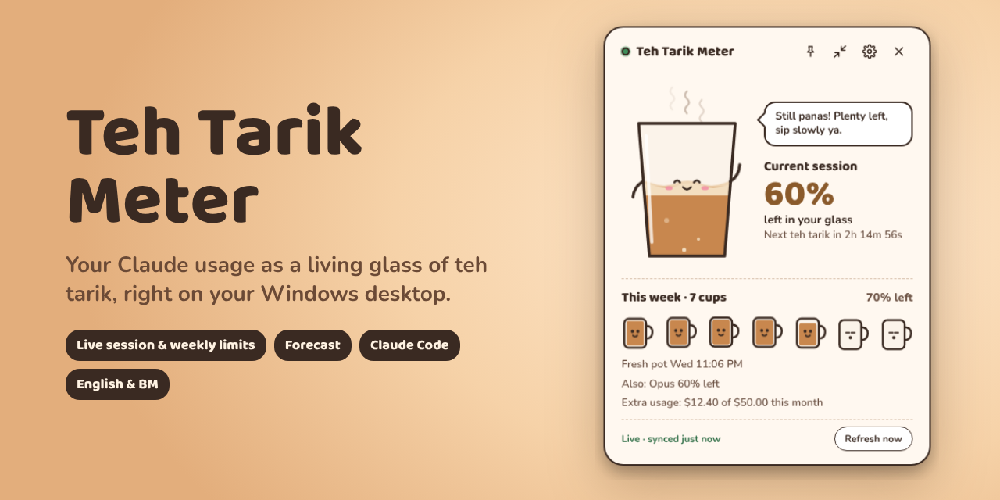
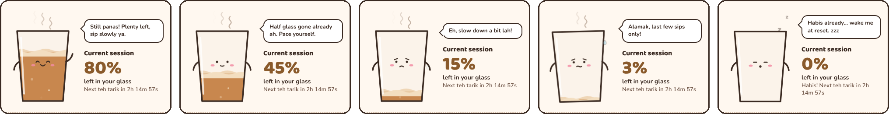
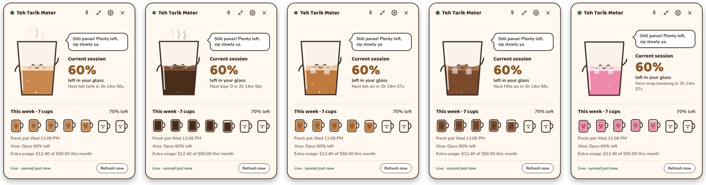
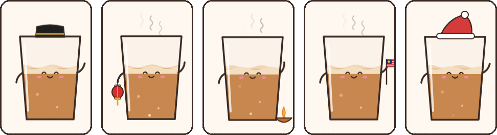
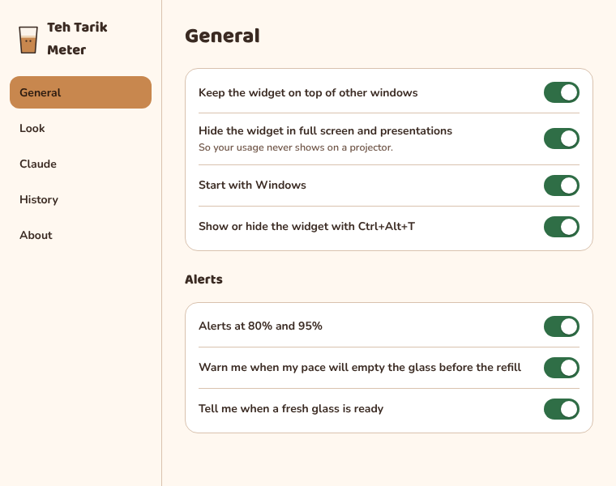
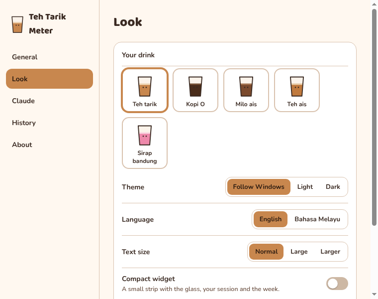
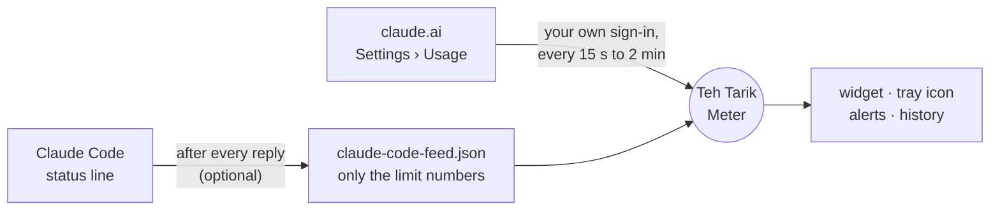

<p align="center">
  
</p>

<p align="center">
  <a href="https://github.com/chowkuanlaw/teh-tarik-meter/releases/latest"></a>
  
  
  <a href="LICENSE"></a>
</p>

<p align="center">
  <b><a href="https://github.com/chowkuanlaw/teh-tarik-meter/releases/latest">Download for Windows</a></b> ·
  <a href="#what-it-does">Features</a> ·
  <a href="#install">Install</a> ·
  <a href="PRIVACY.md">Privacy</a> ·
  <a href="CHANGELOG.md">Changelog</a> ·
  <a href="#ringkasan-bahasa-melayu">Bahasa Melayu</a>
</p>

---

**Teh Tarik Meter** shows your Claude usage limits as a little glass of teh tarik that lives on your desktop. The tea is your current 5-hour session: it drains as you chat and refills when the limit resets. Seven cups underneath are your week. The glass has feelings about all of this.

It's a sibling of [Lapis](https://github.com/chowkuanlaw/lapis-stretch), the kuih stretch reminder, and made the same way: small, free, private, and a bit silly on purpose.

## What it does

| | |
|---|---|
| 🥤 **A glass that drains as you chat** | The tea level is your session. Steam curls up, the foam ripples, the glass blinks and bobs, and a countdown ticks to your next refill. |
| ☕ **Seven cups for the week** | Your weekly limit as a row of cup buddies. Full ones bob, empty ones sleep. Per-model weekly caps (such as Opus) are listed underneath when your plan has them. |
| ⏱️ **"At this pace"** | A forecast from your last hour of use: *"At this pace: runs out 4:02 PM"*, or that it lasts till the refill. An optional alert warns you before you run out. |
| 🔔 **Alerts** | Windows notifications at 80% and 95% (session, week and per-model caps), once per window, plus "fresh glass ready" when your session refills after you hit the limit. |
| ⚡ **Instant with Claude Code** | Connect Claude Code and the glass moves the moment a reply lands. Your own status line keeps working. |
| 📈 **History** | A chart of today's sessions and the past week, kept on your PC for 8 days. |
| 🧋 **Your drink, your look** | Teh tarik, kopi O, Milo ais, teh ais or sirap bandung. Light or dark, English or Bahasa Melayu, bigger text, or a small compact strip. |
| 🙈 **Stays out of the way** | Hides itself during full screen apps and presentations. **Ctrl+Alt+T** shows or hides it. The tray icon drains too, with your numbers on hover. |
| 🎉 **Festive outfits** | Hari Raya, Chinese New Year, Deepavali, Kaamatan, Gawai, Merdeka, Malaysia Day and Christmas. |
| 👀 **Peek before you sign in** | "Peek at a sample first" shows everything with made-up numbers. Nothing is fetched or saved. |

## The glass has moods

<p align="center"></p>

| Session used | Mood | What it says |
|---|---|---|
| under 50% | 😊 happy, waving | *"Still panas! Plenty left, sip slowly ya."* |
| 50 to 80% | 🙂 calm | *"Half glass gone already ah. Pace yourself."* |
| 80 to 95% | 😟 worried, cold drip | *"Eh, slow down a bit lah!"* |
| 95% and up | 😰 shaking | *"Alamak, last few sips only!"* |
| 100% | 😴 asleep | *"Habis already... wake me at reset. zzz"* |

When the session resets, a pulling mug pours a fresh drink into the glass.

## Pick your drink

<p align="center"></p>

The glass, the weekly cups and the tray icon all follow your drink. Iced drinks get ice cubes instead of steam. Change it any time in **Settings › Look**.

## Festive outfits

<p align="center"></p>

The outfit shows for the 4 days before each festival and on the day itself, with a greeting on the day. Turn it off in **Settings › Look** if you prefer a plain glass.

## Settings

<p align="center">
  
  
</p>

Open Settings from the gear on the widget or the tray menu. Five tabs: **General** (on top, hide in full screen, start with Windows, alerts, shortcut), **Look** (theme, language, drink, text size, compact, festive, sound), **Claude** (account, organization, Claude Code), **History** and **About** (version, updates, what's new).

## Where the numbers come from



1. **claude.ai.** The same numbers as your **Settings › Usage** page, read with your own sign-in. The meter checks every 15 seconds while your usage is moving, then slows down step by step to every 2 minutes when it's quiet. It checks straight away when you hover the widget, wake the PC or press **Refresh now**, and pauses while your PC is locked or asleep. claude.ai doesn't publish this as an official API, so a change on their side could break it until an update. If that happens, the widget says so.
2. **Claude Code (optional, instant).** Claude Code hands its status line your limits after every reply. **Connect Claude Code** sets this up: a small script saves only the session and weekly percentages, and the glass moves within a second. It asks before changing anything, backs up your `settings.json`, and keeps your existing status line showing.

Whichever reading is newer wins. The footer of the widget shows when it last synced and from where.

## Install

### From GitHub

1. Download **`TehTarikMeter-Setup-<version>.exe`** from [Releases](https://github.com/chowkuanlaw/teh-tarik-meter/releases/latest) and run it.
2. Windows may say *"Windows protected your PC"* because the installer isn't code-signed. Click **More info**, then **Run anyway**.
3. It installs for you only (no admin needed), starts with Windows, and updates itself from this repository's releases.

### From the Microsoft Store

Coming soon. The Store copy is signed by Microsoft (no SmartScreen warning) and updates through the Store.

### First run

1. A short welcome lets you pick a language and a drink.
2. Click **Sign in to Claude** and sign in on claude.ai's own page. The window closes by itself once you're in.
   - If Google sign-in is blocked there ("this browser may not be secure"), use the email code instead. Or click **Use a session key instead** and paste the `sessionKey` cookie from claude.ai in your browser (DevTools › Application › Cookies).
3. If you use Claude Code, click **Connect Claude Code** for instant updates.
4. Drag the widget anywhere. Right-click the tray icon for the menu.

**Tray menu:** Show/hide · Refresh now · Settings · Compact widget · Keep on top · Connect/Disconnect Claude Code · Open claude.ai usage page · Sign in/out · Check for updates · Quit.

## Privacy

| | |
|---|---|
| **Talks to** | claude.ai (your usage numbers, as you) and GitHub (update checks, installer version only). Nothing else. |
| **Never reads** | your chats, projects or files. |
| **Your sign-in** | stays in Electron's cookie store, encrypted with your Windows account. **Sign out** clears it. |
| **Claude Code script** | keeps only the used percentage and reset time; your prompts, paths and session ids are ignored. |
| **Stored on your PC** | settings, an 8-day usage history and the last reading, in `%APPDATA%\Teh Tarik Meter`. No analytics, no telemetry, no server. |

Full details in [PRIVACY.md](PRIVACY.md).

## FAQ

**Is this an official Anthropic app?**
No. It's an independent app made by a Claude user. See [Trademarks](#trademarks).

**Does it use my API credits or make Claude slower?**
No. It reads the same usage page you can open on claude.ai, a few times a minute at most, and never sends prompts.

**Which plans does it work with?**
Any claude.ai account with a Settings › Usage page. The Claude Code instant feed needs a plan whose status line includes rate limits (Pro and Max).

**Why does Windows warn me when I install it?**
The GitHub installer isn't code-signed, which costs money every year. The Microsoft Store version is signed by Microsoft.

**Is there a Mac version?**
Not at the moment; it's Windows only.

**It says "claude.ai changed its usage page".**
claude.ai changed how it reports usage. The meter keeps the last reading, checks for an update, and tells you once. An update fixes it.

## Develop

```
npm install
npm test                 # automatic tests
npm start                # run against your real claude.ai account
npm run demo             # fake numbers, no network (TTM_DEMO_SESSION=85, TTM_LANG=ms, TTM_THEME=dark, TTM_FESTIVAL=raya, TTM_DEMO_HISTORY=1)
npm run dist:installer   # build the Windows installer into dist/installer
```

To release, bump `version` in `package.json`, add a `## <version>` section to `CHANGELOG.md`, commit, then either push a tag `v<version>` or run the **Release** workflow from the Actions tab with that tag. It tests, builds on Windows, smoke-tests the app and publishes the installer, with that version's changelog as the release notes.

**Microsoft Store:** the **Store package** workflow builds `TehTarikMeter-Store-<version>.appx` by itself whenever `package.json` changes on `main` (or run it by hand); download it from the run's Artifacts. The Partner Center identity is in `package.json` (`build.appx`). The listing text, screenshots, certification notes and a test list are in [`store/`](store/listing.md). The Store copy keeps the Claude Code bridge in `%USERPROFILE%\.teh-tarik-meter`, because Windows keeps a packaged app's AppData private.

## Ringkasan Bahasa Melayu

**Teh Tarik Meter** menunjukkan had penggunaan Claude anda sebagai segelas teh tarik comel di desktop Windows. Paras teh ialah sesi semasa anda: ia surut semasa anda berbual dan penuh semula apabila had ditetapkan semula. Tujuh cawan di bawah ialah minggu anda.

- Ramalan *"Pada kadar ini: habis 4:02 PTG"*, amaran pada 80% dan 95%, dan carta sejarah.
- Kemas kini serta-merta dengan Claude Code.
- Lima minuman (teh tarik, kopi O, Milo ais, teh ais, sirap bandung), mod gelap, dan semua skrin dalam Bahasa Melayu.
- Pakaian perayaan untuk Hari Raya, Tahun Baru Cina, Deepavali, Kaamatan, Gawai, Merdeka, Hari Malaysia dan Krismas.

Muat turun dari [Releases](https://github.com/chowkuanlaw/teh-tarik-meter/releases/latest). Jika Windows memaparkan amaran, klik **More info**, kemudian **Run anyway**. Tukar bahasa di **Tetapan › Rupa › Bahasa**. Apl ini tidak membaca perbualan anda dan tidak menghantar apa-apa tentang anda ke tempat lain.

## Trademarks

Teh Tarik Meter is an independent app. It is not made, endorsed or supported by Anthropic. Claude is a trademark of Anthropic, PBC. Milo is a trademark of Société des Produits Nestlé S.A., used here only as the name of a drink; Teh Tarik Meter is not connected with Nestlé.

## Licence

MIT. Fonts: Baloo 2 and Nunito, SIL Open Font License (see `renderer/fonts`).
